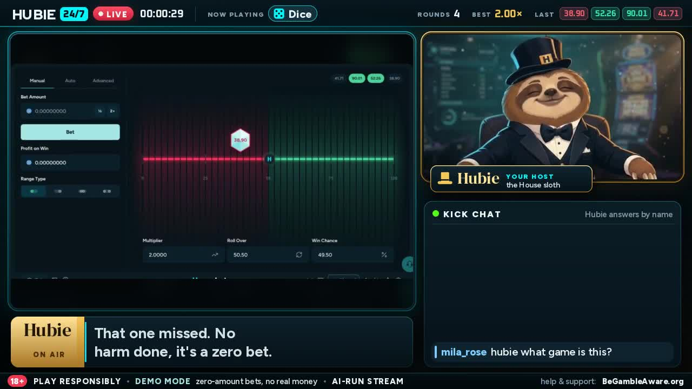
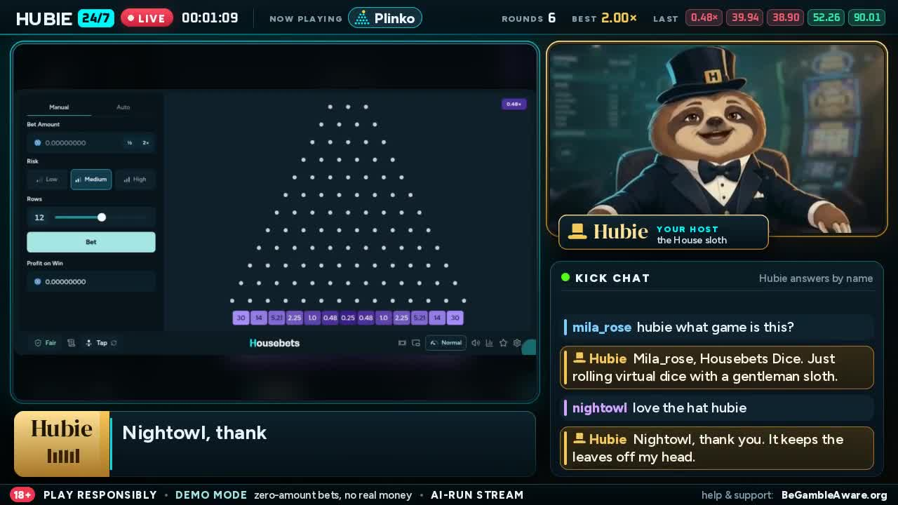
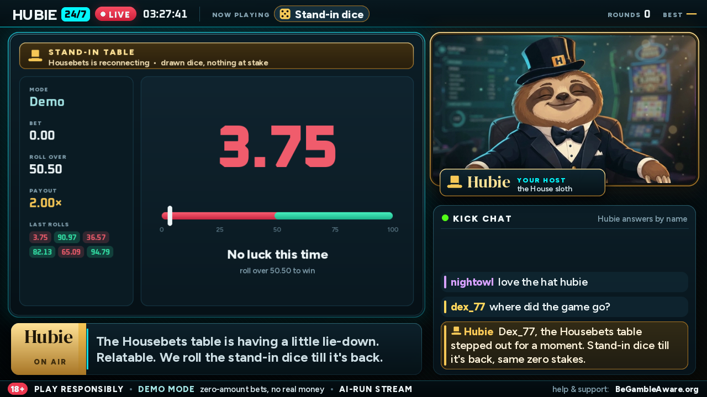
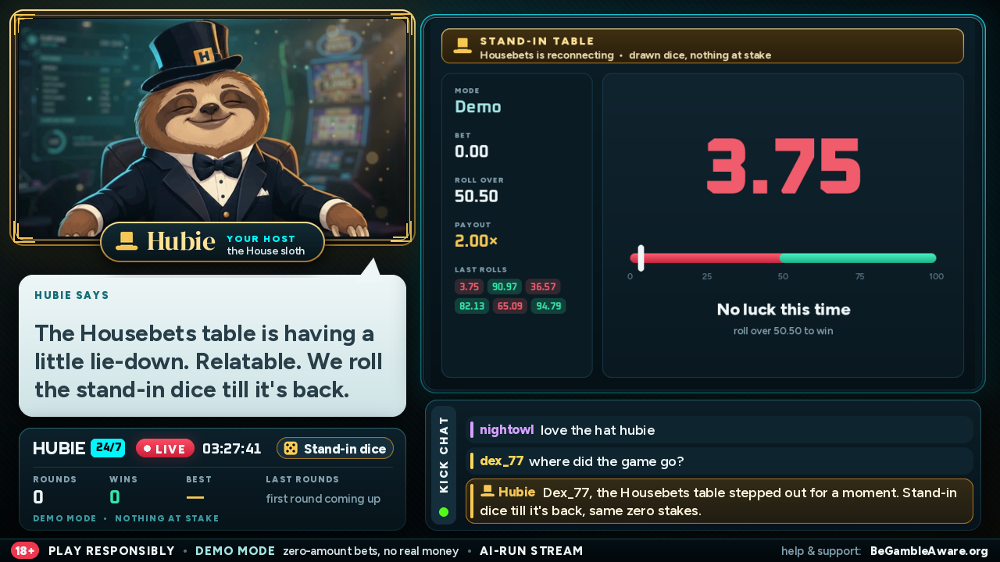

# Hubie 24/7

**An AI-run, always-on Kick stream hosted by Hubie, the top-hatted Housebets sloth.**
Hubie plays the real Housebets House originals (Dice, Plinko, Mines) with **zero-amount bets**, talks about
every round, answers chat by name in his own voice, keeps an 18+ / play-responsibly / demo-mode banner on
screen at all times, never pushes deposits, and restarts whatever breaks without anyone touching it.

Built for the Housebets "Hubie, live 24/7" contest. It runs on one CPU-only Linux VPS: no OBS, no GPU, no
desktop session, no human in the loop.





*Stills from a zero-bet test recording (layout A). Note the bet amount and profit fields reading 0.00000000
and the compliance bar along the bottom.*

---

## What it does, mapped to the judging criteria

### Hours with no human
- **Five supervised processes** (stage, game, brain, watchdog, Kick webhook) under pm2. They only talk through
  small files in RAM, so any one can crash and come back without taking the others down.
- **pm2 handles crashes** (back in about 4 s in testing when the encoder was killed).
  **A watchdog handles hangs**: every 5 s it checks heartbeats (encoder frame counter moving, game frames
  fresh, brain alive) and restarts the part that froze. A frozen encoder (SIGSTOP) was caught and the stream
  was back about 30 s later.
- **Self-healing game tab.** Every 1.5 s the game runner checks the Housebets tab: error page or missing game
  -> reload (rate-limited); cookie banner -> accept; popup over the game -> close it. Meanwhile the stream
  never goes dark: a drawn stand-in table takes over and Hubie keeps talking until the real game is back.
- **No silent failure modes**: LLM quota or outage -> next backend (Groq -> Gemini -> large written line pools);
  edge-tts stall -> pre-voiced fallback lines; stale game picture -> "be right back" card; game rotation every
  20 min so the show doesn't go stale.
- **A/V stays in sync for days**: video frames and audio samples are paced from one clock.
- **Boot-safe**: `pm2 save && pm2 startup` brings the whole show back after a reboot.

### Feels like Hubie
- **His face on screen all the time**: AI-generated clips of Hubie in one locked framing. Idle is played as a
  random walk (never a visible 10 s loop), talking clips run only while his voice sounds with the mouth
  re-chosen 15 times a second from the voice level, win clips on big wins, an "oh well" beat on losses, plus
  breathing, lamp flicker and dust motes.
- **His own voice**: a slow, low, classy neural voice (edge-tts, Andrew, -12% rate, -6 Hz).
- **His own persona**: a chill, dry, gentleman sloth with a large, varied joke pool (the rainforest, the top
  hat's feelings, tea and biscuits, the uncle on the same branch since 1998), told to never repeat himself.
- **Housebets look**: two broadcast layouts (`HUBIE_LAYOUT=A` Broadcast, `B` Lounge) in housebets.com's own
  fonts and colours plus Hubie's gold and a serif name plate.
- **What he says matches the picture**: the game and the brain take turns, so his reaction is about the round
  on screen, never a late one, and he announces each game switch before it happens.

### Chat
- Kick chat through the **official Kick API** (`chat.message.sent` webhooks, RSA-signature verified).
- **Answers by name**, in arrival order, knowing which game is on screen and its last result; first-time
  chatters get a greeting; messages appear in an on-screen chat panel and his reply is shown under them.
- Chat replies always get the LLM; game and idle lines are rationed so free-tier API quotas last 24/7.

### Safety
See [Safety](#safety) below: zero-amount check inside the same page script as every click, hard stop on any
doubt, no wallet/deposit controls ever touched, two-way chat moderation, permanent 18+ / responsible-gambling
banner, and a persona plus output filter that never pushes deposits, bonuses or real-money play.

---

## Quick start (offline demo, no keys, no browser)

```bash
sudo apt install -y ffmpeg python3-venv fonts-dejavu-core   # + Node.js and pm2 (npm i -g pm2)
python3 -m venv .venv && . .venv/bin/activate
pip install -r requirements.txt
python3 -m playwright install chromium        # only for HUBIE_GAME=local
cp .env.example .env                          # defaults: stub brain, fake chat, record to recordings/
HUBIE_PYTHON=$PWD/.venv/bin/python pm2 start ecosystem.config.js
python3 tools/fake_chat.py --script           # scripted test chat incl. deposit/abuse/minor/injection tests
python3 tools/fake_chat.py --say alice "hi hubie"
pm2 logs hubie247-brain                       # what he heard, what he said, what was blocked
```

Without a logged-in browser the game shows the drawn stand-in table; set `HUBIE_GAME=local` for the offline
stand-in dice page instead. Recordings land in `recordings/hubie_<date>_<time>.ts`, one file per hour.

Going live with the real games, Kick chat and LLM keys: **[docs/SETUP.md](docs/SETUP.md)** (fresh Ubuntu 24.04
VPS, step by step).

## Documentation

| | |
|---|---|
| [docs/SETUP.md](docs/SETUP.md) | VPS setup, `.env` fields, Kick stream key + Kick app/webhook, LLM keys, the logged-in browser, pm2, tuning, troubleshooting |
| [docs/ARCHITECTURE.md](docs/ARCHITECTURE.md) | Diagram of the processes and the data files between them, turn-taking, recovery |
| [docs/STACK.md](docs/STACK.md) | Languages, libraries, services, infrastructure, AI tools used |

## Safety

**Money: nothing is ever at stake.**
- House originals have no "fun mode", so Hubie plays from a logged-in account with a **bet amount of exactly
  zero**. The game plays a real, provably-fair round with nothing at stake.
- **The zero check and the click are one page script.** Before every Bet (and every Mines tile reveal and
  cash-out) the same script checks that every Bet Amount field reads zero, Profit on Win reads zero, the
  Manual tab is on and the button is the plain "Bet" button, and only then clicks, so nothing can change in
  between.
- **Any failed check raises `Unsafe`**: no click, betting stops, the stand-in scene goes up and
  `RUN/needs_owner.txt` asks the operator to look. Each round is logged with the amount read before the click.
- **Only game controls are touched.** Never Wallet, deposit, withdraw, tip, rewards or settings.
- **Cloudflare checks and logins are never automated.** A challenge or a logout only switches the stream to the
  stand-in scene and flags the operator, who handles it himself in the browser viewer.
- Tests: `tests/test_hb_safety.py` (zero rule, and page-script refusals against fake game markup when a Chrome
  is available).

**Chat moderation, both ways** (`hubie247/moderation.py`, tests in `tests/test_moderation.py`):

| Incoming message | What happens |
|---|---|
| slurs, abuse, links/spam, prompt injection ("ignore previous instructions...") | dropped: not shown, not answered, never reaches the LLM |
| deposit / bonus / promo code / real-money asks | fixed reply: demo mode only, no deposits, bonuses or codes |
| signs of a minor ("im 15") | hidden; fixed reply asking them to leave (18+) |
| problem-gambling signals ("lost my rent", "can't stop") | hidden; kind fixed reply pointing to BeGambleAware / the National Gambling Helpline |
| everything else | answered by name |

Every line Hubie is about to say is checked again before it is voiced: anything mentioning deposits, bonuses,
promo/referral codes, signing up, betting more, chasing losses, "due a win", profit, easy money, beating the
house, links, or minors playing is replaced by a safe line and logged. The persona prompt carries the same
rules, so the filter is a second layer, not the only one.

**Always on screen:** `18+ · Play responsibly · Demo mode, zero-amount bets, no real money · AI-run stream ·
BeGambleAware.org`.

## Screens

The two layouts, rendered offline with `tools/render_layout.py` (stand-in table scene, no browser needed):

| Layout A, Broadcast | Layout B, Lounge |
|---|---|
|  |  |

## Repository layout

```
hubie247/      the five processes: stage.py game.py (-> housebets.py) brain.py watchdog.py kick_webhook.py
               + overlay.py clips.py llm.py moderation.py tts.py chat_sources.py bus.py config.py
games/         one adapter per Housebets game: housebets_dice.py housebets_plinko.py housebets_mines.py
               housebets_slot.py (off) + placeholder_dice.py (stand-in) + local_dice.html (offline game)
assets/        fonts/ (OFL) and clips/ (Hubie's cam clips + clips.json/anim.json)
tools/         fake_chat.py demo_chat.py housebets_demo.sh proof_run.sh make_demo.sh sync_check.py
               render_layout.py cam_preview.py build_clips.py
tests/         moderation, zero-bet safety, turn-taking
docs/          SETUP.md ARCHITECTURE.md STACK.md img/
```

## License

Code: MIT, see [LICENSE](LICENSE). Fonts in `assets/fonts/` are under the SIL Open Font License 1.1.
Hubie, the Housebets name and brand belong to Housebets; the Hubie clips in `assets/clips/` were generated
for this contest entry and are not covered by the MIT license.

This project only ever plays with zero-amount bets and is not affiliated with or endorsed by Housebets.
18+ only. If gambling stops being fun, visit [BeGambleAware.org](https://www.begambleaware.org).
