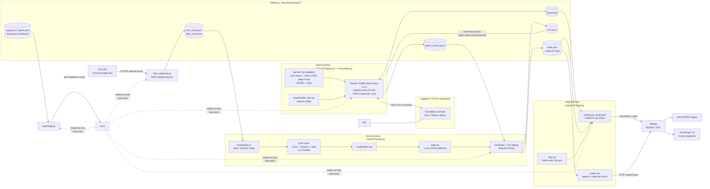

# Architecture

Hubie 24/7 is five small Python processes plus a Chrome and ffmpeg, all supervised by pm2 on one CPU-only
VPS. The processes never call each other: they exchange small files in a RAM folder (`HUBIE_RUN_DIR`,
default `/dev/shm/hubie247`). Snapshots are written atomically (write + rename), events are append-only JSONL.
Any process can crash, hang or restart without taking the others down, and the live state can be inspected
with `cat`.

## The processes

| pm2 name | Module | Job |
|---|---|---|
| `hubie247-game` | `hubie247/game.py` -> `hubie247/housebets.py` | Drives the Housebets tab, plays zero-bet rounds, writes the game picture and round results |
| `hubie247-brain` | `hubie247/brain.py` | Reads chat and game events, moderates, writes Hubie's lines (LLM), voices them, schedules who speaks when |
| `hubie247-stage` | `hubie247/stage.py` | Draws every frame, mixes audio, feeds one ffmpeg encoder (Kick and/or hourly files) |
| `hubie247-watchdog` | `hubie247/watchdog.py` | Restarts parts that hang without crashing |
| `hubie247-kickhook` | `hubie247/kick_webhook.py` | Receives Kick chat webhooks, verifies signatures, appends to `kick_chat.jsonl` |
| (separate) | your own Chrome (see SETUP.md section 6) | The logged-in Chrome on Xvfb that the operator logs in to himself |

### game
- Attaches over the Chrome DevTools Protocol (`HUBIE_HB_CDP`) to the already logged-in Chrome. It never
  launches its own browser and works in the same tab the operator sees in the viewer.
- **Health every 1.5 s**: Cloudflare challenge or logged out -> stand-in scene + `RUN/needs_owner.txt` (never
  clicked or solved by code); error page or missing game -> reload at most every 90 s, flag after 3 min;
  cookie banner -> Accept; popup over the game -> Escape, then the popup's own backdrop. It resumes on its own
  when the tab is healthy and removes the flag.
- **Adapters** (`games/`, one class per game behind `games/base.py:HBGame`) know one page each: when it's
  ready, which rectangle to show, how to check and place a zero bet, how to read the result.
  The check and the click are one `page.evaluate` script; any doubt raises `Unsafe`.
- **Picture**: CDP screencast of the tab, cropped to the game, ~10 fps (`HUBIE_HB_FPS`) into `game.jpg`.
- **Rotation**: `HUBIE_HB_ROTATION` (dice, plinko, mines) every `HUBIE_HB_ROTATE_MIN` minutes, only between
  rounds, announced by Hubie first.
- Results go to `game_events.jsonl` (for the brain and the stage) and `logs/housebets_rounds.jsonl`
  (every round, with the bet amount read before the click).

### brain
- **Chat sources** (`chat_sources.py`): `kickhook` (official webhooks, tails `kick_chat.jsonl`), `fake`
  (local testing), `kick` (legacy public socket).
- **Moderation in** (`moderation.py`): drop / canned reply / answer. Dropped messages never reach the LLM.
- **LLM** (`llm.py`): one persona prompt, short spoken lines. With `ANTHROPIC_API_KEY` it uses Claude;
  otherwise `ChainBrain` tries Groq, then Gemini, and falls back to large written line pools (the stub).
  A failing backend cools down for `HUBIE_LLM_COOLDOWN` s. Chat replies always get the LLM; game and idle
  lines use it at most once per `HUBIE_LLM_EVENT_GAP` s so free-tier quotas last all day.
- **Moderation out**: every line is checked before it is voiced; blocked lines are replaced and logged.
- **Voice** (`tts.py`): edge-tts with hedged retries (a second request starts if the first stalls), converted
  to 48 kHz PCM for the stage. A small pool of win/loss lines per game is voiced ahead of time, so a slow TTS
  call never leaves a round without a reaction.
- **Turn-taking** (what he says matches the picture): each round has an id. After a result the game holds the
  next round until Hubie has said his reaction to that round (plus a short pause), and while he answers chat;
  all waits are capped so the show never freezes. A reaction that went stale (newer round, too old) is
  dropped, never said late. Game switches are announced ("next up: Plinko") before the card and the
  navigation. Speaking order when the stage is free: safety replies > switch announcement > reaction > chat >
  idle.

### stage
- Builds every 1280x720 frame in Python (numpy, Pillow, OpenCV): game area, Hubie's cam with name plate, his
  caption (word by word as he speaks), the chat panel, LIVE + time on air, now playing, session stats, the
  "next up" card and the compliance bar. Static parts are drawn once; text layers only when they change.
- **Clips** (`clips.py`, `assets/clips/clips.json`): idle as a random walk between calm frames, talk only while
  the voice sounds with a voice-driven mouth, weighted win clips, a loss beat built from idle frames, all
  states blended onto the closest-matching frame.
- **Output**: raw frames on stdin and PCM on a named pipe into one ffmpeg (libx264, AAC). Video and audio are
  paced from one clock. `HUBIE_RTMP_URL` set -> FLV to Kick (optionally also hourly local copies with
  `HUBIE_RECORD_LIVE=1`); empty -> hourly MPEG-TS files in `recordings/`.
- If `game.jpg` is older than 8 s, a "be right back" card is shown instead of a frozen picture.

### watchdog
pm2 restarts what exits; the watchdog catches what hangs. Every 5 s: stage heartbeat stale or ffmpeg frame
counter not moving for `HUBIE_WD_STALL` s -> restart stage; game or brain heartbeat older than 30 s ->
restart it. A grace period (`HUBIE_WD_GRACE`) follows each restart. Actions are logged to
`logs/watchdog.jsonl`.

## Data files

In `HUBIE_RUN_DIR` (RAM, nothing needs to survive a reboot):

| File | Writer -> reader | Content |
|---|---|---|
| `game.jpg` | game -> stage | latest game crop |
| `game.json` | game -> watchdog, stage, brain | heartbeat, current adapter/label, page state |
| `game_events.jsonl` | game -> brain, stage | `round_start`, `round` (result, multiplier), `game_state` (ready / blocked / switch_pending) |
| `turn.json` | brain -> game | released round id, speaking / chat busy, switch acknowledged |
| `state.json` | brain -> stage | caption, chat rows, speech queue (paths to PCM), clip events |
| `speech/*.pcm` | brain -> stage | voiced lines, s16le 48 kHz stereo |
| `voice_cache/` | brain | pre-voiced fallback lines |
| `stage.json` | stage -> brain, watchdog | heartbeat, frames written, ffmpeg frame count, speech started / done |
| `brain.json` | brain -> watchdog | heartbeat |
| `kick_chat.jsonl` | kick_webhook -> brain | verified chat messages |
| `fake_chat.jsonl` | tools/fake_chat.py -> brain | test chat |

In the repo folder (git-ignored): `logs/` (brain_events, housebets_rounds, watchdog, stage_timeline),
`recordings/` (hourly segments), `RUN/needs_owner.txt` (what the operator should look at).

## Testing tools

- `tools/proof_run.sh [seconds] [crash_at]`: whole stack under pm2 with the scripted test chat, kills the encoder
  once to show recovery (`MODE=hang` freezes it instead, so only the watchdog can catch it).
- `tools/housebets_demo.sh [seconds] [rotate_min]`: game + stage + brain in a separate RAM dir, file output only
  (never streams), with timed test chat (`HUBIE_DEMO_CHAT`).
- `tools/sync_check.py <recording.mp4>`: timing table per event (reaction said while its result is on screen,
  switch announced before the switch, chat answered in order) using the logs and the real audio onsets.
- `tools/render_layout.py`, `tools/cam_preview.py`: stills of both layouts, Hubie's cam alone.
- `tests/`: moderation, zero-bet refusals, turn-taking (offline: stub LLM, fake TTS, simulated stage).
